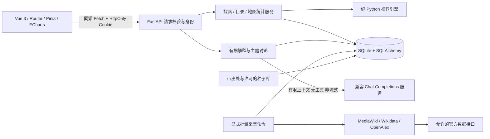

# UnKnown 架构与信任边界

UnKnown 是面向单机自托管的模块化单体。Vue 页面、FastAPI API 和 SQLite 文件共同构成可离线运行的探索路径；在线采集和 LLM 是可选扩展。它不测量知识掌握程度，不把行为记录当作学习成效证明。

## 运行结构

开发时 Vite 将 `/api` 代理至 `127.0.0.1:8000`。构建后 FastAPI 直接提供 `frontend/dist`，页面与接口同源。`scripts/serve.sh` 明确启动一个 worker；当前实现不支持用多个 worker 提升并行容量。

Python 3.11–3.13、Node 22.12+，依赖由 `backend/uv.lock` 与 `frontend/package-lock.json` 锁定。不要求 Docker、本地大模型、向量数据库、图数据库、消息队列或常驻采集进程。

## 代码边界

| 位置 | 职责 | 不承担的职责 |
| --- | --- | --- |
| `frontend/src` | 五个页面、加载/错误状态、用户操作、可见卡片曝光、图谱交互 | 保存服务端 Key、决定用户 ID、伪造知识节点 |
| `backend/app/api/routes.py` | Cookie 身份、Pydantic 输入、HTTP 状态、单请求事务与用户隔离 | 直接抓取用户 URL、让模型创建候选 |
| `backend/app/services/catalog.py` | 幂等种子/在线目录导入、来源与当前状态序列化 | 根据同名标题盲目合并实体 |
| `backend/app/services/discovery.py` | 历史前缀、用户时区日期、批次/幂等/刷新额度、快照 | 推荐请求中同步等待采集或 LLM |
| `backend/app/recommendation` | 纯函数特征、三个策略、动态多样性、配额可行性和降级 | 数据库读写、网络、未来事件 |
| `backend/app/ai` | 证据束、Provider、严格结构/引用校验、缓存、预算、讨论隔离 | 执行工具、文件访问、网页抓取、自动证明引用蕴含 |
| `backend/app/ingestion` | 固定官方端点、有限重试、缓存、采集 checkpoint 与重跑 | 全量百科镜像、任意 URL 代理、把论文元数据当全文 |
| `backend/app/services/insights.py` | 基于数据库状态的有限子图与统计 | 硬编码图节点、知识掌握百分比 |

## 持久化与事务

SQLite 启用外键、WAL 和有上限的 busy timeout。迁移使用 Alembic，初始目录从明确的种子文件幂等导入。代码许可不替代来源数据的各自许可。

| 表组 | 记录内容 |
| --- | --- |
| `disciplines`、`subfields`、`topics`、`topic_disciplines` | 版本化分类、持久化稳定细分 ID、唯一统计主学科、相关展示学科、中文整理摘要与原文短摘 |
| `topic_sources`、`topic_relations` | 分离的来源版本/内容哈希/许可、保留语义方向和证据的关系 |
| `anonymous_profiles` | 匿名凭据哈希、时区、熟悉学科、深度、强度与广域历史选项 |
| `user_topic_events`、`user_topic_states` | 不可替代的事件历史与可修改的当前学习/熟悉状态 |
| `bookmarks` | 独立收藏布尔状态，与学习状态共存 |
| `daily_recommendations`、`recommendation_items` | 当前批次、父批次、幂等键、排序、依据与可复现快照 |
| `exposure_events` | 已实际展示的卡片，独立于推荐生成记录 |
| `ai_explanations`、`ai_usage`、`chat_messages` | 非个人共享解释、预算账本、按匿名档案隔离的私有讨论 |
| `ingestion_jobs` | 显式采集任务状态、checkpoint、成功/失败计数与原因 |

外键、复合主键和唯一约束防止悬空关系、重复收藏、重复反馈和重复批次。请求校验失败不进入业务写操作；业务异常回滚事务。刷新幂等键绑定当前档案，复用到其他模式返回冲突。

API 事务是单个请求的业务单位。身份依赖与数据库依赖在事件循环中完成短小的同步本地操作，请求依赖使用 function scope，在交付响应前提交或回滚，避免另一个请求在前一事务尚待提交时阻塞写入。创建推荐前取得 SQLite `BEGIN IMMEDIATE` 并重新读取当前批次。AI 入口先提交身份事务，再等待网络，避免在整个模型调用期间持有目录写事务。四个同时提交的同 Cookie 初始推荐、相同幂等键刷新、收藏和反馈都有独立并发回归；详细结果见验收文档。

## 匿名身份、隐私与清除

服务端创建 32 字节随机会话材料，浏览器通过 HttpOnly、SameSite=Lax Cookie 提交；数据库保存凭据的 SHA-256 哈希。API 从 Cookie 找当前档案，忽略不了的额外 `user_id` 字段会被输入模型拒绝。HTTPS 部署时须设置 `COOKIE_SECURE=true`。当前没有账号、跨设备同步或档案找回；清除浏览器身份后可能失去原匿名档案的访问入口。

修改类请求检查 Origin；开发跨域仅允许配置中的来源。错误统一包含代码、简明信息和请求标识，日志只记录必要错误类型/请求标识，不输出 Key、完整会话凭据或聊天正文。

用户确认清除时删除当前档案的事件、当前学习状态、收藏、曝光、推荐历史和私有讨论，重置初始熟悉领域。共享知识库和非个人 AI 解释保留。AI 使用账本去除该档案关联后仍保留全局额度会计信息，防止隐私清除导致全局预算丢失。

讨论采用档案/主题锁和清除世代标识；清除前已发出的模型请求即使稍后返回，也不能把旧讨论重新写入数据库。清除不可能撤销已经发送到外部供应商的请求。供应商的数据处理政策仍应由自托管使用者自行选择。

## 推荐批次与行为含义

批次按匿名档案、用户时区日期、模式和批号保存。同一天重复读取返回该模式最新批次；切换模式返回对应已有批次；只有“换一组”创建新批次并保存父批次关系。偏好改变只影响新批次，当前页面显示设置变更提示。

客户端在卡片真实进入可见范围后报告曝光。打开详情写入访问事件，第一次成功打开详情另记一次探索。探索、此前已了解、此前完全陌生、正在学习、已理解与收藏是不同状态；不点击不会产生负反馈，短期跳过不会永久封禁学科。

推荐保存候选、配置、历史前缀、随机种子、特征、动态选择顺序和降级结果。相同快照可重放，不读取未来行为。三种策略及约束细节见 [RECOMMENDATION.md](RECOMMENDATION.md)。

## AI 证据链与调用边界

1. 从本地当前主题来源中读取有限摘录，使用真实来源记录 ID；中文整理摘要另加标签。
2. 将资料放入用户消息中的 JSON 数据对象，系统任务保持固定。来源和用户问题都是不可信数据。
3. 通过固定服务端 Base URL 调用兼容 Chat Completions；不提供工具、函数执行、任意网页或文件读取能力。默认不假设 JSON mode 可用，需显式配置。
4. 校验结构、核心字段、类比边界、允许来源 ID；模型新生成的 HTTP URL/额外来源结构被拒绝，UI 的来源链接只从服务端元数据解析。
5. 缓存键包含主题、深度、语言、供应商配置、模型、提示版本、来源短摘及内容哈希/修订版本。共享解释不包含个人历史；讨论按档案隔离。
6. 相同解释任务在单进程内合并；请求前按用户和全局预留最坏情况预算，记录供应商实际 usage。缺失或不合格 usage 保持未知并使用保守预留；发生多次尝试时保留整个请求的保守预算，避免把前次超时的潜在用量漏掉。重试次数、上下文和输出均有上限。无 Key 时不调用远程服务。

结构有效或引用 ID 有效不代表资料支持每一句陈述，也不能证明真实模型不会受到所有提示注入攻击。可控替身测试验证的是提示分区、权限缺失、输出拒绝和故障恢复。真实供应商生成、代表性来源支持性人工抽查的状态单独记录，不能用替身结果冒充通过。

AI 错误返回独立区域，原始短摘、来源、收藏、反馈和地图始终可用。页面刷新不自动创建远程生成任务；没有 Key 时按需请求只返回可理解的不可用状态。

## 地图与统计口径

ECharts Graph 数据来自真实目录及当前档案状态。节点包括主学科、按主学科和细分名称生成、持久化稳定 ID 的细分节点、主题；颜色表示主学科，学科节点大小表示该档案已探索主题数。主题学习状态、收藏和访问状态可并存。

默认限制子图，支持限定节点数和一至两层展开；边上限 300、节点上限 150。只返回两端存在的边。分类边与有出处的关系边有不同类型，不把 AI 类比写入正式关系。较小屏幕使用列表入口，不能靠把整张图缩小维持可操作性。

统计以当前匿名档案为范围：探索数按主题 ID 累计去重；已接触学科按唯一主学科；最近 30 天分布是窗口内首次探索的主题；最近新增学科取首次探索时间；跨领域路径只包含连续首次探索中存在对应定向有据关系的跳转。它不是完整点击流路径挖掘。未探索和超过 30 天未再访问的范围都仅限当前知识库，不是“全部人类知识”的覆盖率。

## 资源边界与已知扩展点

- 单机、单 worker 是当前明确部署边界。AI 任务去重、请求预算预留互斥和讨论清除世代都包含进程内协调；多 worker/多实例必须先引入跨进程事务锁、持久化 generation epoch 或任务系统，并补并发测试。
- 目录与图谱请求有数量上限；推荐候选当前最多读取 10,000 条；地图最多读取 10,000 个主题后截断返回有限子图。这适合几百至几千条目录，不是大规模索引方案。
- SQLite 事务采用同步数据库操作；单机小数据时简单可靠，繁重采集/更大目录应与交互负载分离，再评估异步驱动或其他数据库，不能仅增加 worker。
- 同一时刻应只运行一个主动采集命令写入某个任务；不会启动无限后台采集。官方接口认证、限额与实际访问结果见数据来源文档。
- 当前已实现正文/引用结构校验，没有自动事实蕴含验证、真实学习结果评价、完整长期随机实验或跨设备身份迁移。
- 离线评估使用明确合成的历史前缀，仅描述策略行为。自述陌生率在没有真实反馈时为 null，不从点击或停留时间补算。

## 本轮探索交互补充（2026-11-17）

详情页使用导航世代隔离详情、关联、历史讨论、收藏、反馈和 AI 响应；解释另有请求世代，防止同主题切换深度后串结果。读取关联或讨论失败可以局部重试，不阻塞资料阅读。历史快照晚于新问题返回时保留当前对话，并提供重新读取完整历史的入口，不按文本猜测消息身份。

推荐卡片把原始批次 ID 随可见事件一起上报，失败最多重试一次。换组请求的幂等标识在同一次未确认操作中复用。前端只在 sessionStorage 保存模式，滚动位置和未确认操作留在内存；完整刷新仍从后端读取当天最新批次。

学习列表沿用 user_topic_states，按当前 Cookie 档案、学习状态在 SQL 层筛选及分页，按标题和 ID 稳定排序。不增加时间字段或迁移，也不声称排序代表学习更新次序。跳过有效期沿用 skipped_until；撤销只清除此字段。关系序列化补齐两端标题，旧批次不回写；地图根主题优先保留在节点预算内。
